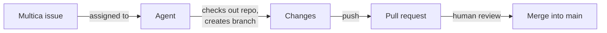

<div align="center">

# multica-test

**A sandbox repository for testing the [Multica](https://github.com/multica-ai/multica) platform.**

[](https://github.com/multica-ai/multica)
[](#about)
[](https://github.com/saumon/multica-test/commits/main)
[](https://github.com/saumon/multica-test/issues)
[](https://github.com/saumon/multica-test/pulls)
[](https://github.com/saumon/multica-test/graphs/contributors)
[](https://github.com/saumon/multica-test)

</div>

---

## Table of contents

- [About](#about)
- [How it is used](#how-it-is-used)
- [Repository structure](#repository-structure)
- [Getting started](#getting-started)
- [Contributing](#contributing)
- [License](#license)

## About

This project exists solely to test [Multica](https://github.com/multica-ai/multica).

It contains no production code: it is used to verify how the platform works (agents, issues, repositories, pull requests, etc.).

> [!NOTE]
> Nothing in this repository is meant to be deployed or reused. Changes here are experiments driven by Multica issues.

## How it is used

Issues are created on the Multica board and assigned to coding agents. Each agent checks out this repository, works on a dedicated branch, and opens a pull request for human review.



What this sandbox lets you verify:

- **Agents** — an agent picks up an issue and acts on it autonomously.
- **Issues** — status transitions, comments and wakeups on the Multica board.
- **Repositories** — checkout of a GitHub repository on a dedicated branch.
- **Pull requests** — branch push, PR creation and linking back to the issue.

## Repository structure

```text
.
└── README.md   # This file
```

## Getting started

Clone the repository:

```bash
git clone https://github.com/saumon/multica-test.git
cd multica-test
```

There is nothing to build, install or run.

## Contributing

1. Create an issue on the Multica board describing the change.
2. Let an agent (or yourself) work on a dedicated branch — never push directly to `main`.
3. Open a pull request and link it to the issue.
4. A human reviews and merges.

## License

No license has been specified for this repository yet. Until one is added, all rights are reserved by the repository owner.
